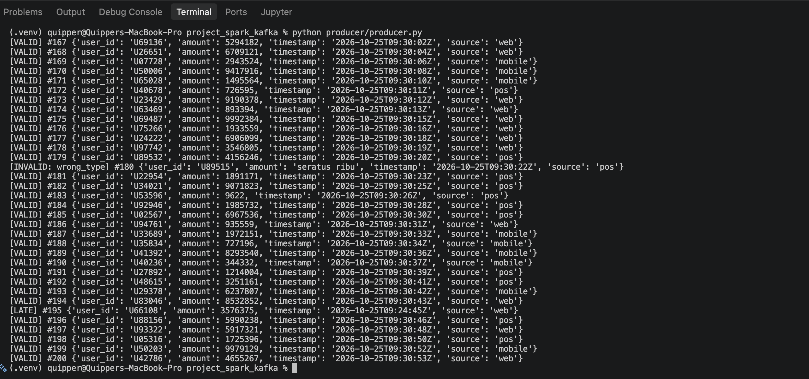
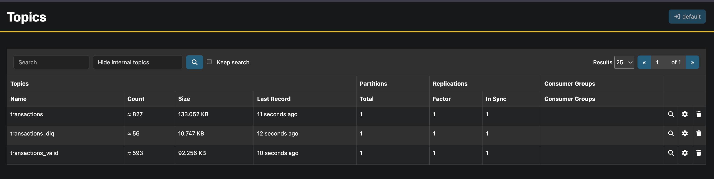
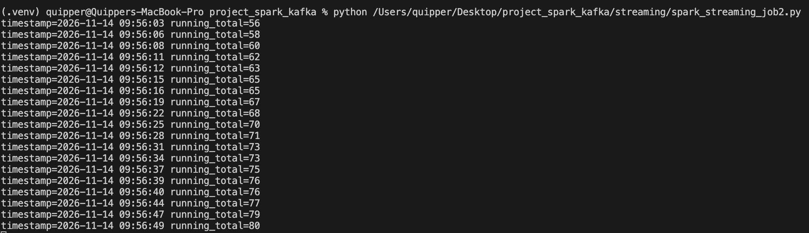

# Streaming for Data Pipeline: Kafka + Spark Structured Streaming

## Deskripsi dan arsitektur

Project ini membaca event JSON dari Kafka, memvalidasinya dengan PySpark
Structured Streaming, lalu merutekan event valid dan invalid ke topic terpisah.

```text
producer -> Kafka: transactions -> Spark Structured Streaming
                                -> Kafka: transactions_valid
                                -> Kafka: transactions_dlq
```

## Event Producer

`producer/producer.py` mensimulasikan aliran transaksi ke Kafka:

- Mengirim event transaksi JSON ke topic `transactions` setiap **1–2 detik**
  (`random.uniform(1, 2)`).
- Mensimulasikan data kotor yang realistis dengan menyisipkan event khusus
  secara terjadwal (`SCHEDULE`):
  - **Event INVALID** (lebih dari 3 jenis): field hilang, `amount` null,
    `amount` bertipe salah (`"seratus ribu"`), `amount` negatif, `amount`
    terlalu besar, `source` tidak dikenal (`atm`), timestamp tidak valid.
  - **Event LATE**: event valid yang `timestamp`-nya mundur 5–10 menit untuk
    menguji mekanisme watermark.
  - **Event DUPLICATE**: event valid yang dikirim ulang persis sama
    (`user_id` + `timestamp` identik) untuk menguji deduplikasi.
- Setiap event dicetak ke console dengan label (`VALID`, `INVALID: ...`,
  `LATE`, `DUPLICATE`) untuk memudahkan verifikasi.

## Bentuk Data (Skema Event)

Setiap event adalah JSON dengan 4 field:

```json
{
  "user_id": "U12345",
  "amount": 150000,
  "timestamp": "2025-12-14T09:00:20Z",
  "source": "mobile"
}
```

| Field       | Tipe   | Keterangan                                        |
|-------------|--------|---------------------------------------------------|
| `user_id`   | string | ID pengguna, format `U` + 5 digit                 |
| `amount`    | number | Nominal transaksi, valid pada rentang 1–10.000.000 |
| `timestamp` | string | ISO 8601 UTC dengan akhiran `Z` (event time)      |
| `source`    | string | Kanal transaksi: `mobile`, `web`, atau `pos`      |

## Spark Streaming Job

`streaming/spark_streaming_job.py` melakukan pipeline ETL secara real-time:

1. **Read** — membaca topic `transactions` dari Kafka
   (`spark.readStream.format("kafka")`) dan deserialize JSON menjadi
   DataFrame dengan schema terdefinisi (`from_json` + `StructType`).
   Kolom `timestamp` diparsing ke event time dengan `try_to_timestamp` dan
   diberi **watermark 3 menit** (`withWatermark("ts", "3 minutes")`).
2. **Validate** — menerapkan 5 validasi wajib (lihat section Validasi) dan
   menambahkan kolom `is_valid` serta `error_reason` ke setiap event.
3. **Route (foreachBatch)** — per micro-batch:
   - event valid → ditulis ke Kafka topic `transactions_valid`;
   - event invalid (gagal validasi, duplikat, atau terlambat melewati
     watermark) → ditulis ke Kafka topic `transactions_dlq` beserta
     `error_reason`-nya.
4. **Monitor** — menghitung total transaksi valid per tumbling window 1
   menit dan mencetak `timestamp` (waktu Spark melakukan output) serta
   `running_total` (total kumulatif transaksi valid) ke console.
5. **Checkpoint** — progress offset Kafka disimpan di checkpoint directory
   agar job dapat melanjutkan dari posisi terakhir saat di-restart.

## Validasi

Job mendefinisikan schema JSON, lalu memberi setiap event kolom `is_valid` dan
`error_reason`. Event valid memiliki `error_reason: null`; event invalid
memuat alasan kegagalan pertamanya.

1. Field wajib `user_id`, `amount`, dan `timestamp` harus ada dan tidak null.
2. Tipe JSON divalidasi: `amount` harus bisa di-cast ke angka (`try_cast`)
   dan `timestamp` harus bisa diparsing sebagai timestamp
   (`try_to_timestamp`); fungsi `try_*` aman terhadap ANSI mode Spark 4.
3. `amount` harus berada dalam rentang 1–10.000.000.
4. `source` harus salah satu dari `mobile`, `web`, atau `pos`.
5. Duplikat ditentukan oleh pasangan `user_id` + `timestamp`.

Selain 5 validasi di atas, event yang tiba lebih dari **3 menit** setelah
event time-nya (melewati watermark) juga dianggap invalid dengan alasan
`late event beyond watermark` dan dikirim ke DLQ.

Kafka sink bersifat at-least-once. Jika proses gagal ketika sedang menulis ke
topic output, sebagian event dari micro-batch dapat terkirim ulang saat recovery.

## Tumbling Window Monitoring

Selain validasi dan routing, job menjalankan monitoring menggunakan tumbling
window:

- **Window size**: 1 menit (`window(ts, "1 minute")`) di atas event valid.
- **Event time**: agregasi berdasarkan kolom `timestamp` dari event.
- **Watermark**: 3 menit. Event yang tiba lebih dari 3 menit setelah event
  time-nya dianggap **late** dan otomatis di-drop dari agregasi oleh Spark
  (mekanisme deteksi late event).
- **Output**: ditampilkan ke console berisi `timestamp` (waktu Spark
  melakukan output) dan `running_total` (total kumulatif transaksi valid).

## Dokumentasi

Output dari producer.py:


Monitoring di akhq:


Output dari spark_streaming_job.py:

